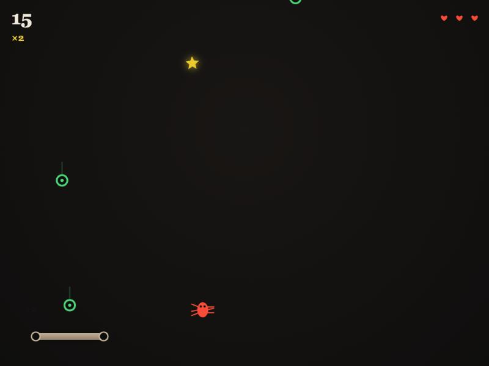

# Commit Catcher

A tiny browser game: catch the good stuff, dodge the bombs.

**[▶ Play it here](https://fefezey.github.io/commit-catcher/)**

## How to play

| Falling thing | What it is | What happens |
|---|---|---|
| Green ring | Commit | Catch it: +1 |
| Pink heart | Heart | Rare. Catch it: one life back |
| Bomb | Bomb | Touch it and you lose a life |

- You have 3 lives. A bomb costs one. So does every fifth face you miss.
- Every 5 commits in a row raises your multiplier (up to ×5). Missing one or hitting a bomb resets it.
- Everything gets faster the longer you survive. A new level starts every 12 seconds.

**Controls:** move with the mouse, a finger, or the arrow keys. Tap or press Space to start.

## Run it locally

No build step and no dependencies. Open `index.html` in a browser.

## About

Day 1 of [Git Laki](https://github.com/fefezey/git-laki): every day a wheel picks what I ship to GitHub.
This time it landed on "Browser game".

One HTML file, plain JavaScript and a canvas.

## License

MIT
